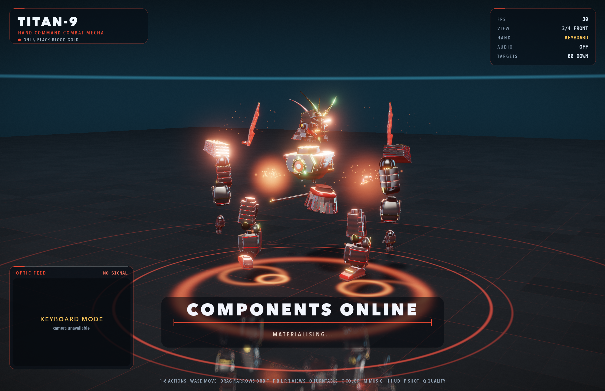
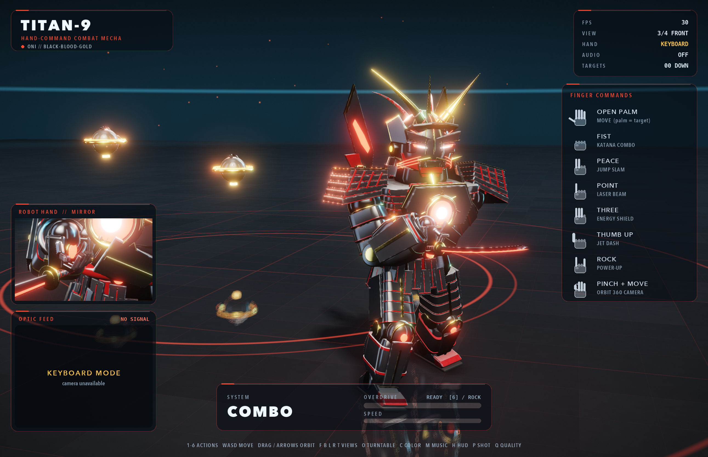

# TITAN-9 — Oni Samurai Hand-Command Mecha

A real-time, GPU-rendered **black-lacquer oni samurai mecha** (yakuza menace + samurai armour) that you summon and
control with your **hand** through the webcam. PBR rendering (OpenGL 4.1 via `moderngl`), full 360° camera, a katana
move-set with human-like motion, procedural sound + music, and a live HUD — all in Python on your Mac.

**macOS / Linux:**
```bash
./run_titan.sh              # webcam hand control (the full reveal show)
./run_titan.sh --demo       # scripted showcase, no camera needed
./run_titan.sh --no-camera  # keyboard + mouse only  (press ENTER to advance the reveal)
./run_titan.sh --no-reveal  # skip the reveal, start with the robot built
```

**Windows 10 / 11 (64-bit) — one click, installs everything:**

Extract the whole ZIP, then **double-click `START_WINDOWS.bat`**. The first run automatically installs Python 3.11,
the Visual C++ runtime and all packages (≈10–20 min, needs internet), checks the laptop camera and graphics, then
starts the game. Later runs start in seconds. If anything fails, a full log is saved to `setup_windows.log`.
```bat
START_WINDOWS.bat                    REM webcam hand control (same as run_titan.bat)
START_WINDOWS.bat --demo             REM scripted showcase, no camera needed
START_WINDOWS.bat --no-camera        REM keyboard + mouse only
START_WINDOWS.bat --quality medium   REM slower laptops (or: low)
START_WINDOWS.bat --camera 1         REM pick another camera (USB webcam)
START_WINDOWS.bat --check            REM only test camera + graphics
START_WINDOWS.bat --reinstall        REM rebuild the Python environment from scratch
```
Windows keeps its own environment in `.venv-win`, so it never clashes with the Mac `.venv`.
Camera not found? Close Zoom/Teams/Camera app, then allow *Settings → Privacy & security → Camera → Let desktop apps access your camera*.

| | |
|---|---|
|  |  |

## The reveal (hand workflow)

1. **Empty stage** — only the arena and pulsing summoning rings. No robot.
2. **Show an OPEN HAND** — the robot's 22 components pop up one by one (dissolve-in, sparks, a *pop* sound each) and float in an exploded view.
3. **Close your hand into a FIST** — every component flies in, clamps onto the powered-down body with a metal **clank** and sparks, the reactor ignites and the mecha stands up (boot-up surge).
4. The robot **stays built** and is yours to control. (Your fist is ignored until you open your hand, so it doesn't instantly trigger the combo.)
   Press **`X`** any time to hide it and replay the show. `ENTER` does steps 2–3 from the keyboard.

## Finger commands (hybrid control)

Your **palm position** steers the robot; **finger poses** trigger the power moves.

| Gesture | Action |
|---|---|
| ✋ **Open palm / any in-between pose** | **MOVE** — walks to where your palm is (floor target ring). Its fingers copy yours. |
| ✊ **Fist** (hold) | **KATANA COMBO** — quick-draw cut › diagonal cut › rising cut › front kick › spinning cut › diagonal › overhead finisher with a slash-wave. Release → it flicks and **sheathes** the blade. |
| ✌️ **Peace** | **JUMP SLAM** — crouch, rocket launch, dive, superhero landing + shockwave |
| ☝️ **Point** (hold) | **LASER BEAM** — palm repulsor; finger tilt turns the robot, hand height aims up/down |
| 🤟 **Three fingers** (hold) | **ENERGY SHIELD** — hex-grid bubble |
| 👍 **Thumbs up** | **JET DASH** — thruster flight + skid |
| 🤘 **Rock** | **POWER-UP** — charge, shockwave, 14 s **OVERDRIVE** |
| 👌 **Pinch + move** | **ORBIT 360° CAMERA** |

Power moves interrupt held actions instantly. The **ROBOT HAND** panel shows a live close-up of the robot copying your fingers.

## Keyboard & mouse (always available)

| Key | |
|---|---|
| `Enter` | advance the reveal (open hand → fist) · `X` replay the reveal |
| `W A S D` (+`Shift`) | move (camera-relative), sprint |
| `1`/`Space` jump · `2` katana combo (hold) · `3` dash · `4` laser (hold, `A/D/W/S` aim) · `5` shield (hold) · `6` power-up | actions |
| Drag mouse · arrow keys · scroll / `+` `-` | orbit · zoom |
| `F` front · `B` back · `L` left · `R` right · `T` top · `V` cycle | camera presets (relative to the robot's heading) |
| `O` | 360° turntable |
| `C` | colour scheme (ONI black-blood-gold · SHOGUN white-crimson · NIGHT stealth-neon) |
| `M` music · `H` HUD · `Q` quality · `P` screenshot (`screenshots/`) · `Esc` quit |

## What makes the motion human-like

* **Foot-planted IK locomotion** — analytic two-bone leg IK: heel strike → stance (foot fixed in the world, no sliding) → toe-off → swing, pelvis bob, torso counter-rotation, arm swing; walk and run with a flight phase.
* **Arm IK for the sword** — the blade path is authored (hilt position, blade direction, edge roll) and the arms follow; two-handed grips, a hand resting on the hilt at idle, the left hand steadying the saya.
* **Second-order follow-through** on torso, head and arms, a head that tracks the camera, breathing and weight-shift, cross-fades between actions, and hit-stop / slow-mo on impacts.

## Options

```
--demo  --no-camera  --no-reveal  --camera N  --mute  --no-music  --fullscreen  --quality {high,medium,low}
--size W H  --no-vsync  --shot out.png --frames N   (render N frames, save a screenshot, exit)
```

## How it works

```
titan/
  geometry.py    procedural hard-surface kit: lofts, lathes, bevelled plates, tubes
  mecha_model.py the oni samurai mecha: lamellar do, sode, kusazuri, kabuto + fanged menpo, katana + saya (~110k tris)
  skeleton.py    46-bone skeleton (incl. 20 finger bones), forward kinematics
  ik.py          two-bone IK solver (legs + arms)
  animation.py   pose engine, gait IK, springs, head look, sword IK, the action set
  reveal.py      hand-gated reveal state machine (parts, assembly, boot)
  renderer.py    shadow map · planar reflection · SSAO · PBR · bloom · ACES · FXAA (+ per-part dissolve/hologram FX)
  shaders.py     GLSL (GGX PBR, lacquer clear-coat, IBL, panel-line + edge-wear detail)
  fx.py          particles, shock rings, camera shake, hit-stop / slow-mo
  hand_input.py  threaded MediaPipe tracking, joint-angle finger curls, debounced gestures
  audio.py       every sound + music synthesised in numpy (no asset files)
  hud.py         glass HUD, live camera feed, robot-hand mirror, reveal prompts
  targets.py drones · camera.py orbit camera · app.py window/input/main loop
tools/           still.py (stills) · sim_render.py (action contact sheets)
tests/           ik · gestures · app pipeline · reveal workflow · soak
docs/            screenshots of the full flow
```

Run all tests:
`for t in ik gestures app_pipeline reveal soak; do ./.venv/bin/python3 tests/test_$t.py; done`

Requires macOS with a GPU supporting OpenGL 4.1 (any Mac), Python 3.9+, and a webcam for hand control.
The original CyberPuppet (OpenCV) project files are untouched; its README is saved as `README_legacy_cyberpuppet.md`.
